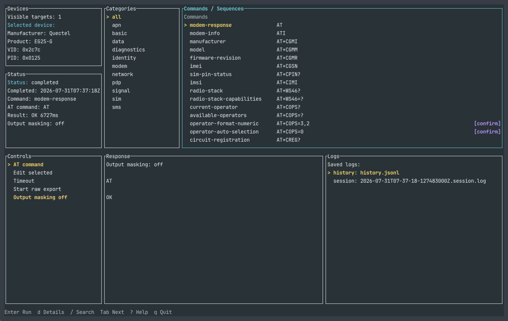

# atctl

[English README](README.md)

`atctl` は、Apple Silicon搭載MacからUSBセルラーモデムへATコマンドを
送信・管理するためのRust製CLI/TUIです。

macOSが利用可能な`/dev/cu.*`シリアルデバイスを公開しない場合も含め、
`libusb`でUSBへ直接アクセスします。



## 対応・検証範囲

- Mac: Apple Silicon搭載Mac
- USBモデム: SORACOM Onyx LTE USB Dongle
- 内蔵モデム: Quectel EG25-G
- USB ID: `0x2c7c:0x0125`
- 確認したファームウェア: `EG25GGBR07A08M2G`（`ATI`、2026-06-17）

この環境では、次のワークフローを実機で確認しています。

- `devices`によるUSBデバイス検出、`inspect`によるディスクリプター確認、
  `AT` / `ATI`の直接実行
- プリセット実行と、マスク済み履歴・セッションログ
- TUIでの候補更新と関連するSequence入力操作
- `screen`を使ったPTYブリッジ操作
- SMSの送信、受信・一覧、読み取り、返信、およびQuectel / SORACOMの
  ping・TCP Sequence

これは検証済み環境であり、広範なモデムやOSへの対応を表明するものでは
ありません。完全な検証範囲と実行時の必要条件は
[インストールガイド](docs/INSTALL.md)を参照してください。

## インストール

Homebrewで`atctl`をインストールします。

```sh
brew install uchimanajet7/atctl/atctl
```

Homebrew Formulaは実行時依存関係の`libusb`もインストールします。必要条件と
インストール後の確認方法は
[インストールガイド](docs/INSTALL.md)
を参照してください。

## 最初の5コマンド

モデムが表示され、ATコマンドに応答することを確認します。

```sh
atctl devices
atctl inspect
atctl send AT
atctl send ATI
atctl tui
```

現在のUSB接続先は`atctl devices`で確認します。想定したモデムが表示されない
場合は`atctl devices --all-usb`を実行し、
[トラブルシューティング](docs/TROUBLESHOOTING.md)
を参照してください。

## 主なワークフロー

- `atctl tui`で対話的に操作する。
- `atctl send <COMMAND>`でATコマンドを1つ送信する。
- `atctl preset list`で繰り返し使う確認処理を探し、
  `atctl preset show <NAME>`で完全な内容を確認してから
  `atctl preset run <NAME>`で実行する。
- `atctl sequence list`でSMSやデータ送信の複数手順を探し、
  `atctl sequence show <SEQUENCE>`で完全な内容を確認してから
  `atctl sequence run <SEQUENCE>`で実行する。
- `atctl bridge --symlink <PATH>`でターミナル用PTYブリッジを利用する。
- raw診断証跡は、出力先と`raw-log`の確認語を明示した場合だけ収集する。

## 安全とログ

ATコマンドは機微な識別子を読み取ったり、モデムの状態を変更したりします。
`atctl`は機微な出力を初期状態でマスクし、状態変更など実質的な影響がある操作では
確認を求めます。未確認のコマンド、送信先の値、外部から取得したプリセットや
Sequence定義は、実行前に確認してください。

通常の`send`、プリセット、Sequence、TUIでの実行は、マスク済みのコマンド履歴と
セッションログを初期状態で書き込みます。

```text
~/.local/state/atctl/history.jsonl
~/.local/state/atctl/logs/<timestamp>.session.log
```

`--no-log`は、その実行で新しい通常ログを作らないだけで、既存ログを削除せず、
別途指定したraw診断エクスポートも無効にしません。raw診断証跡にはマスクして
いない機微データが含まれる場合があり、利用者が出力先を選んで`raw-log`確認語を
入力した場合だけ作成します。

未確認の操作や状態変更操作を行う前に[安全ガイド](docs/SAFETY.md)を参照して
ください。ログの保存先、確認、export、保持、削除は
[ログの確認と管理](docs/TROUBLESHOOTING.md#review-and-manage-logs)、定義の
読み込み、入力支援、実行レビュー、ワークフローの詳細は
[プリセットとSequenceのリファレンス](docs/PRESETS.md)を参照してください。

## 利用者向けドキュメント

以下からリンクする利用者向け・メンテナ向けの詳細文書と
コントリビューションガイドは現在英語です。

- [インストール](docs/INSTALL.md)
- [プリセットとSequenceのリファレンス](docs/PRESETS.md)
- [安全ガイド](docs/SAFETY.md)
- [トラブルシューティング](docs/TROUBLESHOOTING.md)

## 質問・報告

利用上の質問、不具合報告、機能提案は、既存の
[GitHub Issues](https://github.com/uchimanajet7/atctl/issues)を検索し、
該当するものがなければ新しいIssueを作成してください。

セキュリティ脆弱性の疑いは、公開Issueではなく
[GitHubの非公開脆弱性報告](https://github.com/uchimanajet7/atctl/security/advisories/new)から
報告してください。

不具合報告には、確認できる場合は`atctl`のバージョン、対象のコマンドまたは
TUI操作、再現手順、期待する結果、実際の結果を記載し、必要な場合だけ
確認済みのマスクされた出力を添えてください。公開Issueには、raw診断
エクスポート、マスクしていない出力、認証情報、加入者識別子、電話番号、
メッセージ本文を含めないでください。

## コントリビューション

コードおよびドキュメントのコントリビューションを受け付けています。
Pull Requestを作成する前に、
[コントリビューションガイド](CONTRIBUTING.md)を
参照してください。

## メンテナ向け情報

- [開発ガイド](docs/DEVELOPMENT.md)
- [パッケージングとリリース](docs/PACKAGING.md)
- [製品・技術仕様](docs/SPEC.md)
- [確定済みの製品・アーキテクチャ判断](docs/DECISIONS.md)

## ライセンス

MIT。詳細は[LICENSE](LICENSE)を参照してください。
